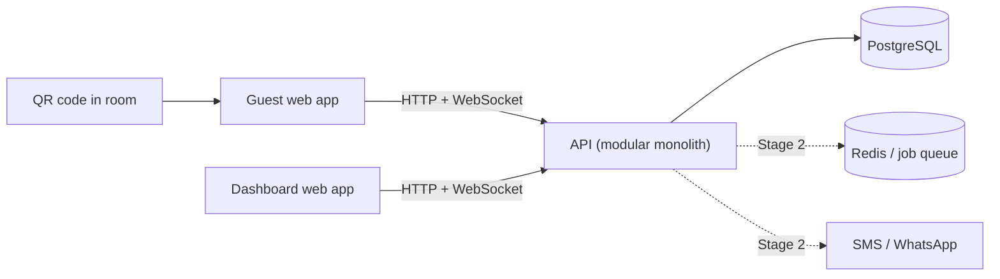
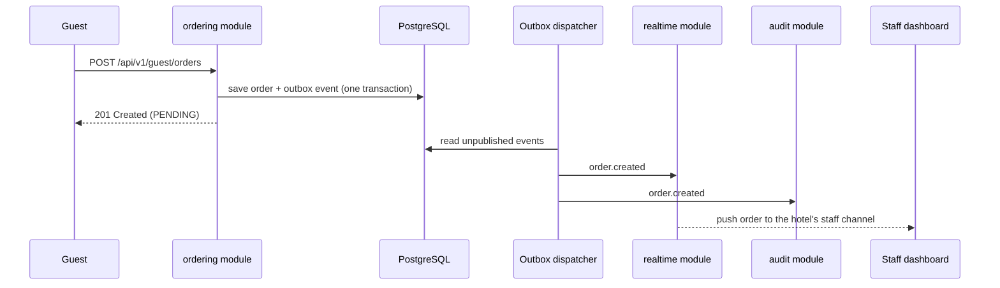

# Guest Experience CRM

An AI-ready digital concierge that replaces the in-room hotel telephone with a QR code.

A guest scans a code in their room and, with **no app install and no login**, can order food, request amenities, and track the request live. Hotel staff receive every request on a real-time dashboard. Owners monitor orders, sales, and staff activity from anywhere.

The platform is **multi-tenant**: many hotels run on one system, and each hotel's data is completely isolated from the others.

> **Status:** pre-alpha. Stage 1 (the core order loop) is in development. See [Roadmap](#roadmap).

---

## Table of contents

1. [How it works](#how-it-works)
2. [Features](#features)
3. [Architecture](#architecture)
4. [Tech stack](#tech-stack)
5. [Repository structure](#repository-structure)
6. [Getting started](#getting-started)
7. [Environment variables](#environment-variables)
8. [Scripts](#scripts)
9. [API overview](#api-overview)
10. [Real-time channels and events](#real-time-channels-and-events)
11. [Modules](#modules)
12. [Architecture rules](#architecture-rules)
13. [Adding a new module](#adding-a-new-module)
14. [Testing](#testing)
15. [Security](#security)
16. [Conventions](#conventions)
17. [Roadmap](#roadmap)
18. [Troubleshooting](#troubleshooting)
19. [Documentation](#documentation)
20. [License](#license)

---

## How it works

1. **Setup.** An admin creates the hotel's rooms and menu, adds staff accounts, and prints a QR code for each room.
2. **Check-in.** A receptionist checks a guest into a room. This starts a *stay*.
3. **Order.** The guest scans the room's QR code, browses the menu, and submits an order. The order is saved as `PENDING` and pushed to staff instantly.
4. **Fulfil.** Staff accept (`IN_PROGRESS`) and deliver (`DELIVERED`) the order. The guest's screen updates at every step.
5. **Pay.** Payment is collected at the front desk and recorded by staff.
6. **Check-out.** The receptionist ends the stay. Every guest session for that room is invalidated immediately, so a photographed QR code is useless afterwards.

### Why the QR code is safe

The QR code contains only a **random, unguessable token**, never the room number. The server looks the token up to find the hotel and room, and it opens a guest session **only if the room has an active stay**.

```
https://your-domain.com/r/k7Qx9v...   ->   token -> hotel + room -> active stay? -> guest session
```

---

## Features

### Stage 1: the core loop

- QR-based guest sessions with server-side validation
- Mobile-first guest menu with categories, item notes, and out-of-stock badges
- Cart and idempotent order submission (retries never create duplicates)
- Live order tracking for guests
- Real-time staff dashboard (Kanban board, sound and visual alerts)
- Order status rules: `PENDING` -> `IN_PROGRESS` -> `DELIVERED`, or `CANCELLED`
- One-tap "mark item unavailable"
- Check-in and check-out
- Payment recording ("mark as paid") for front-desk collection
- Multi-tenant authentication with four cumulative roles
- Room management and print-ready QR code PDF

### Stage 2: trust, money, and owner value

- Escalation alerts (SMS or WhatsApp) when an order is not accepted in time
- Owner dashboard: live activity feed, shift logs, revenue and order metrics
- Reconciliation report (delivered orders vs. payments recorded)
- Response-time metrics by staff member and shift
- AI concierge with strict guardrails (answers only from hotel-approved content, can never submit an order by itself)
- Upsell prompts, time-based menus, per-hotel branding, multi-language guest page
- Bulk menu import, low-stock alerts, daily owner summary, demo mode

---

## Architecture

The backend is an **event-driven modular monolith**: one deployable application, split internally into independent modules that communicate through **events** and each other's **public APIs**. It can be split into services later if ever needed, without redesigning the modules.

### High-level Architecture Design



```
┌────────────────────────────────────────────────────────────────────────────────────────┐
│                                      CLIENT LAYER                                      │
│                                                                                        │
│   ┌───────────────────────────┐                      ┌─────────────────────────────┐   │
│   │       Guest Web App       │                      │      Dashboard Web App      │   │
│   │   (React · QR / Mobile)   │                      │  (React · Staff / Admin)    │   │
│   └─────────────┬─────────────┘                      └──────────────┬──────────────┘   │
└─────────────────┼───────────────────────────────────────────────────┼──────────────────┘
                  │                                                   │
                  │ HTTP (REST) + WebSocket                           │ HTTP (REST) + WebSocket
                  ▼                                                   ▼
┌────────────────────────────────────────────────────────────────────────────────────────┐
│                             API SERVER (Modular Monolith)                              │
│                                                                                        │
│   ┌────────────────────────────────────────────────────────────────────────────────┐   │
│   │        Fastify Gateway  ·  Auth Guards  ·  Rate Limiters  ·  Pino Logger       │   │
│   └────────────────────────────────────────────────────────────────────────────────┘   │
│                                           │                                            │
│   ┌───────────────────────────────────────┴────────────────────────────────────────┐   │
│   │                      INDEPENDENT DOMAIN MODULES                                │   │
│   │                                                                                │   │
│   │   ┌──────────────┐   ┌──────────────┐   ┌──────────────┐   ┌───────────────┐   │   │
│   │   │   identity   │   │    hotels    │   │    rooms     │   │     stays     │   │   │
│   │   └──────────────┘   └──────────────┘   └──────────────┘   └───────────────┘   │   │
│   │   ┌──────────────┐   ┌──────────────┐   ┌──────────────┐   ┌───────────────┐   │   │
│   │   │ guest-access │   │     menu     │   │   ordering   │   │   payments    │   │   │
│   │   └──────────────┘   └──────────────┘   └──────────────┘   └───────────────┘   │   │
│   │   ┌──────────────┐   ┌──────────────┐   ┌──────────────┐   ┌───────────────┐   │   │
│   │   │   realtime   │   │    audit     │   │notifications*│   │  reporting*   │   │   │
│   │   └──────────────┘   └──────────────┘   └──────────────┘   └───────────────┘   │   │
│   │                                                                                │   │
│   │          Public APIs (index.ts)  ◄────────►  Typed In-Process Event Bus        │   │
│   └───────────────────────────────────────┬────────────────────────────────────────┘   │
│                                           │                                            │
│   ┌───────────────────────────────────────┴────────────────────────────────────────┐   │
│   │     SHARED KERNEL: Tenant Scope  ·  Unit of Work  ·  Outbox Dispatcher         │   │
│   └────────────────────────────────────────────────────────────────────────────────┘   │
└─────────────────────┬───────────────────────────────────────────┬──────────────────────┘
                      │                                           │
                      │ SQL (Drizzle ORM)                         │ (Stage 2)
                      ▼                                           ▼
          ┌───────────────────────┐                   ┌───────────────────────┐
          │      PostgreSQL       │                   │    Redis / BullMQ     │
          │  (Module Schemas +    │                   │   (Job Queue & Pub)   │
          │   Transactional Outbox│                   └───────────┬───────────┘
          └───────────────────────┘                               │
                                                                  ▼
                                                      ┌───────────────────────┐
                                                      │    SMS / WhatsApp     │
                                                      │ (Escalations / Alerts)│
                                                      └───────────────────────┘
```

### How an order travels



```
Guest                ordering module          PostgreSQL             Outbox Dispatcher       realtime / audit        Staff Dashboard
  │                         │                     │                          │                      │                       │
  │─── POST /guest/orders ─►│                     │                          │                      │                       │
  │    (Idempotency-Key)    │                     │                          │                      │                       │
  │                         │─── BEGIN TX ───────►│                          │                      │                       │
  │                         │    1. Save Order    │                          │                      │                       │
  │                         │    2. Save Outbox   │                          │                      │                       │
  │                         │       (order.created│                          │                      │                       │
  │                         │◄── COMMIT ──────────│                          │                      │                       │
  │                         │                     │                          │                      │                       │
  │◄── 201 PENDING ─────────│                     │                          │                      │                       │
  │                         │                     │                          │                      │                       │
  │                         │                     │◄── Poll unpublished ─────│                      │                       │
  │                         │                     │─── Return events ───────►│                      │                       │
  │                         │                     │                          │                      │                       │
  │                         │                     │                          │─── order.created ───►│                       │
  │                         │                     │                          │                      │─── Push WebSocket ───►│
  │                         │                     │                          │                      │    (Sound & Visual)   │
  │                         │                     │◄── Mark published ───────│                      │                       │
  │                         │                     │                          │                      │                       │
```

The order and its `order.created` event are saved in **one database transaction** (the *outbox pattern*). An order can therefore never be saved without its event, or the other way round. This is how the system meets the requirement that no order is ever lost.

### Order Status Lifecycle

```
                        ┌──────────────────────────────────────────────┐
                        │                                              │
                        ▼                                              │ (Cancel)
                 ┌──────────────┐      Accept     ┌──────────────┐     │      ┌──────────────┐
  [ Start ] ───► │   PENDING    │ ──────────────► │ IN_PROGRESS  │ ────┴────► │  CANCELLED   │
                 └──────────────┘                 └──────┬───────┘   (Cancel) └──────────────┘
                                                         │
                                                         │ Deliver
                                                         ▼
                                                  ┌──────────────┐
                                                  │  DELIVERED   │
                                                  └──────────────┘
```


---

## Tech stack

| Layer | Choice |
|---|---|
| Language | TypeScript (strict mode) on Node.js 20 LTS or newer |
| HTTP framework | Fastify |
| Validation | Zod (shared schemas in `packages/contracts`) |
| Database | PostgreSQL with Drizzle ORM and SQL migrations |
| Real-time | WebSocket (`ws`) |
| Events | In-process typed event bus with a transactional outbox |
| Background jobs (Stage 2) | Redis with BullMQ |
| Logging | pino |
| Testing | Vitest |
| Package manager | pnpm workspaces |
| Frontends | React (guest app and dashboard app) |
| Local services | Docker Compose |

---

## Repository structure

```
guest-experience-crm/
├── apps/
│   ├── api/                  # the modular monolith (backend)
│   ├── guest-web/            # React app opened by the QR code
│   └── dashboard-web/        # React app for staff, managers, and admins
├── packages/
│   ├── contracts/            # shared types: events, API schemas, WebSocket messages, QR token format
│   └── tsconfig/             # shared TypeScript configs
├── docs/                     # PRD, diagrams, architecture decision records
├── docker-compose.yml
├── pnpm-workspace.yaml
└── README.md
```

Backend layout (`apps/api/src`):

```
src/
├── main.ts          # starts HTTP + WebSocket server
├── app.ts           # composition root: db, event bus, module registration
├── worker.ts        # Stage 2: background process (outbox, timers, jobs)
├── config/          # validated environment variables
├── shared/          # shared kernel: db, events, http, errors, logging, test helpers
└── modules/         # one folder per business area (see Modules)
```

Every module has the same four layers:

```
modules/<name>/
├── index.ts            # PUBLIC API: the only file other modules may import
├── <name>.module.ts    # registers routes, use cases, subscribers
├── domain/             # pure business rules (no framework or database code)
├── application/        # use cases and ports
├── infrastructure/     # database repositories and adapters
├── interface/          # HTTP routes and event subscribers
└── __tests__/
```

---

## Getting started

### Prerequisites

- Node.js 20 LTS or newer
- pnpm 9 or newer (`npm install -g pnpm`)
- Docker and Docker Compose (for PostgreSQL)

### Setup

```bash
# 1. Clone and install
git clone <repo-url> guest-experience-crm
cd guest-experience-crm
pnpm install

# 2. Configure the environment
cp .env.example apps/api/.env
# Edit apps/api/.env and set the JWT secrets (see "Environment variables")

# 3. Start PostgreSQL
pnpm db:up

# 4. Create the tables and load demo data
pnpm db:migrate
pnpm db:seed

# 5. Run everything (API + guest app + dashboard)
pnpm dev
```

| App | URL |
|---|---|
| API | http://localhost:3000 |
| Guest app | http://localhost:5173 |
| Dashboard | http://localhost:5174 |

### Demo data

`pnpm db:seed` creates a demo hotel with rooms, a menu, staff accounts, and sample orders. It prints a QR link for each room:

```
Room 101 (checked in)  ->  http://localhost:5173/r/<token>
Room 102 (vacant)      ->  http://localhost:5173/r/<token>
```

Demo accounts (**local development only. Never use these outside your machine**):

| Role | Email | Password |
|---|---|---|
| Admin | admin@demo-hotel.test | ChangeMe123! |
| Manager | manager@demo-hotel.test | ChangeMe123! |
| Receptionist | reception@demo-hotel.test | ChangeMe123! |
| Staff | kitchen@demo-hotel.test | ChangeMe123! |

### Try the full loop

1. Sign in to the dashboard as **Receptionist** and keep the page open.
2. Open the QR link for **Room 101** on your phone (or a second browser window).
3. Add items and place an order. It appears on the dashboard with a sound alert.
4. Move the order to **In Progress**, then **Delivered**. Watch the guest screen update live.
5. Mark the order as **Paid**.
6. Check Room 101 out, then reload the guest page. It now shows that ordering is unavailable.

---

## Environment variables

Defined and validated in `apps/api/src/config/env.ts`. The API refuses to start if a required value is missing or invalid.

| Variable | Required | Default | Description |
|---|---|---|---|
| `NODE_ENV` | no | `development` | `development`, `test`, or `production` |
| `PORT` | no | `3000` | HTTP port |
| `LOG_LEVEL` | no | `info` | pino log level |
| `DATABASE_URL` | yes | n/a | PostgreSQL connection string |
| `JWT_ACCESS_SECRET` | yes | n/a | Secret for staff access tokens (long and random) |
| `JWT_REFRESH_SECRET` | yes | n/a | Secret for refresh tokens (different from the access secret) |
| `JWT_ACCESS_TTL` | no | `15m` | Access token lifetime |
| `JWT_REFRESH_TTL` | no | `7d` | Refresh token lifetime |
| `GUEST_APP_URL` | yes | n/a | Base URL of the guest app, used inside QR codes |
| `CORS_ORIGINS` | no | guest and dashboard dev URLs | Comma-separated allowed origins |
| `RATE_LIMIT_GUEST_PER_MINUTE` | no | `30` | Per-session limit on guest endpoints |
| `REDIS_URL` | Stage 2 | n/a | Redis connection for background jobs |
| `ESCALATION_FIRST_AFTER_SECONDS` | Stage 2 | `120` | Alert the shift manager if an order is unaccepted |
| `ESCALATION_SECOND_AFTER_SECONDS` | Stage 2 | `300` | Alert the admin if still unaccepted |
| `MESSAGING_PROVIDER` | Stage 2 | n/a | SMS or WhatsApp provider name |
| `MESSAGING_API_KEY` | Stage 2 | n/a | Provider credentials |
| `LLM_API_KEY` | Stage 2 | n/a | Credentials for the AI concierge |

Never commit `.env` files. Only `.env.example` belongs in the repository.

---

## Scripts

Run from the repository root.

| Command | What it does |
|---|---|
| `pnpm dev` | Runs the API, guest app, and dashboard together |
| `pnpm dev:api` | Runs only the API with auto-reload |
| `pnpm dev:guest` | Runs only the guest app |
| `pnpm dev:dashboard` | Runs only the dashboard |
| `pnpm db:up` / `pnpm db:down` | Starts or stops local PostgreSQL (Docker) |
| `pnpm db:migrate` | Applies pending SQL migrations |
| `pnpm db:generate` | Generates a migration from schema changes |
| `pnpm db:seed` | Loads the demo hotel |
| `pnpm db:reset` | Drops, recreates, migrates, and seeds the local database |
| `pnpm test` | Runs all tests |
| `pnpm test:architecture` | Checks the module-boundary rules |
| `pnpm test:integration` | Runs integration tests against a test database |
| `pnpm lint` | Lints the whole repository |
| `pnpm typecheck` | Type-checks every package |
| `pnpm build` | Builds all apps for production |

---

## API overview

Base path: `/api/v1`. Request and response shapes live in `packages/contracts/src/api`, and are the source of truth.

### Guest (no login; requires a guest session)

| Method | Path | Purpose |
|---|---|---|
| `POST` | `/guest/sessions` | Start a session from a QR token |
| `GET` | `/guest/menu` | Menu for the guest's hotel |
| `POST` | `/guest/orders` | Submit an order (requires an `Idempotency-Key` header) |
| `GET` | `/guest/orders` | Orders placed from this room |

### Staff

| Method | Path | Minimum role | Purpose |
|---|---|---|---|
| `POST` | `/auth/login`, `/auth/refresh`, `/auth/logout` | n/a | Sign in and out |
| `GET` | `/orders` | Staff | List the hotel's orders |
| `PATCH` | `/orders/:id/status` | Staff | Advance or cancel an order |
| `POST` | `/orders/:id/payments` | Receptionist | Mark an order as paid |
| `PATCH` | `/menu/items/:id/availability` | Receptionist | One-tap available / unavailable |
| `POST` | `/rooms/:id/check-in` | Receptionist | Start a stay |
| `POST` | `/stays/:id/check-out` | Receptionist | End a stay and invalidate sessions |
| `GET/POST/PATCH/DELETE` | `/menu/categories`, `/menu/items` | Manager | Manage the menu |
| `GET/POST/PATCH` | `/users` | Manager (limited) / Admin | Manage accounts |
| `GET/POST/PATCH` | `/rooms`, `POST /rooms/bulk` | Admin | Manage rooms |
| `POST` | `/rooms/:id/qr/regenerate` | Admin | Replace a room's QR token |
| `GET` | `/rooms/qr.pdf` | Admin | Download print-ready QR codes |

### Roles

Roles are **cumulative**: each role can do everything the roles below it can.

```
Admin  ⊃  Manager  ⊃  Receptionist  ⊃  Staff
```

Permissions are enforced on the server for every request, not only hidden in the interface.

---

## Real-time channels and events

| Channel | Who connects | Receives |
|---|---|---|
| `/ws/guest` | A guest with a valid session | Events for their own room only |
| `/ws/staff` | Signed-in staff | Events for their own hotel only |

Connections that are unauthenticated, or that try to subscribe to another hotel or room, are rejected.

### Domain events

Event types are defined once in `packages/contracts/src/events`. Modules import them from there, never from each other.

| Event | Raised by | Consumed by |
|---|---|---|
| `order.created` | ordering | realtime, audit, notifications (Stage 2) |
| `order.status_changed` | ordering | realtime, audit, reporting (Stage 2) |
| `payment.recorded` | payments | realtime, audit, reporting (Stage 2) |
| `item.availability_changed` | menu | realtime, audit |
| `stay.checked_in` | stays | audit |
| `stay.checked_out` | stays | guest-access (invalidates sessions), audit |
| `guest_session.invalidated` | guest-access | realtime (closes guest connections), audit |
| `user.deactivated` | identity | realtime (closes staff connections), audit |

Every event carries `hotelId`, `occurredAt`, and the ID of what changed.

---

## Modules

| Module | Owner | Responsibility | Stage |
|---|---|---|---|
| `identity` | B | Staff login, users, roles, permissions | 1 |
| `hotels` | B | Tenants | 1 |
| `rooms` | B | Rooms, QR tokens, QR PDF | 1 |
| `stays` | B | Check-in and check-out | 1 |
| `menu` | B | Categories, items, availability | 1 |
| `payments` | B | Payment records (cash, card, transfer) | 1 |
| `audit` | B | Activity log built from events | 1 |
| `guest-access` | A | QR token resolution, guest sessions | 1 |
| `ordering` | A | Orders, status rules (State pattern), pricing | 1 |
| `realtime` | A | WebSocket gateway and channel authorization | 1 |
| `notifications` | A | Escalation, SMS and WhatsApp | 2 |
| `concierge` | A | AI assistant with guardrails | 2 |
| `reporting` | B | Metrics, reconciliation, owner summary | 2 |

*Owner A = guest and real-time engineer. Owner B = operations and admin engineer.*

---

## Architecture rules

These rules keep the monolith modular. They are checked automatically in CI.

| Rule | How it is enforced |
|---|---|
| A module may import another module only through its `index.ts` | ESLint boundary rules, `dependency-cruiser`, and `test:architecture` |
| Modules never read another module's tables | One PostgreSQL schema per module (for example `ordering.orders`, `menu.items`) |
| Cross-module reactions use events, not direct calls | Example: `stays` raises `stay.checked_out`, and `guest-access` invalidates sessions in its own subscriber |
| Domain code has no framework, database, or HTTP imports | Only `infrastructure/` and `interface/` may import Fastify or Drizzle |
| Event types come from `packages/contracts` | Subscribers never import another module's event classes |
| Every query is scoped to a hotel | `shared/db/tenant-scope.ts` applies `hotel_id` filtering; tenant isolation is covered by integration tests |
| Prices are always calculated on the server | Client-sent prices are ignored in `ordering` |
| State changes go through the domain | Aggregates keep private state and expose methods like `order.advance()` |

---

## Adding a new module

1. Create `apps/api/src/modules/<name>/` with the four layers (`domain`, `application`, `infrastructure`, `interface`).
2. Expose only what other modules need from `index.ts`. Keep everything else internal.
3. Give the module its own PostgreSQL schema and add its tables to `shared/db/schema.ts`.
4. Generate a migration with `pnpm db:generate`.
5. If other modules must react to something that happens here, add an event type to `packages/contracts/src/events` and raise it from the aggregate.
6. Register the module in `app.ts`.
7. Add unit tests for the domain, and an integration test for the main flow.
8. Run `pnpm lint && pnpm typecheck && pnpm test` before opening a pull request.

---

## Testing

| Level | Location | What it proves |
|---|---|---|
| Unit | `modules/*/__tests__` | Domain rules, such as valid and invalid order transitions |
| Architecture | `apps/api/test/architecture` | No module imports another module's internals |
| Integration | `apps/api/test/integration` | Real database: order flow, check-out invalidating sessions, **tenant isolation** with two hotels |
| End to end | `apps/api/test/e2e` | QR scan to delivered order over HTTP and WebSocket |

Tests that must never be skipped:

- **Tenant isolation:** with two seeded hotels, no list, search, detail, or real-time endpoint leaks the other hotel's data.
- **Check-out:** a guest session stops working the moment the stay ends.
- **Idempotency:** submitting the same order twice creates one order.
- **No lost orders:** restarting the API does not lose an order or its event.

---

## Security

- **QR tokens** are random and unguessable. They never contain the room number. Admins can regenerate any room's token.
- **Guest sessions** only exist during an active stay and end at check-out.
- **Staff passwords** are hashed. Access tokens are short-lived; refresh tokens rotate.
- **Roles** are checked on the server for every request.
- **Rate limiting** applies to guest endpoints, per session and per room.
- **Order integrity:** prices are computed on the server, and submission is idempotent.
- **Tenant isolation:** every query and every real-time subscription is scoped to the caller's hotel.
- **Secrets** come from environment variables only and are never committed.
- **AI concierge (Stage 2):** it may answer only from approved hotel content, and it can draft a request but never submit one without the guest's confirmation. This protects against prompt injection.

To report a vulnerability, contact the maintainers privately. Do not open a public issue.

---

## Conventions

### Code

- TypeScript `strict` mode. No `any` without a comment explaining why.
- File names use kebab-case with a role suffix: `place-order.use-case.ts`, `order.repository.ts`, `order-created.event.ts`.
- Use the branded ID types from `shared/domain/ids.ts` (`HotelId`, `OrderId`, and so on) instead of plain strings.
- Time comes from the injectable `clock`, never from `Date.now()` in domain code.
- Validate all external input with Zod at the edge (HTTP and WebSocket).

### Git

- Branches: `feature/<short-name>`, `fix/<short-name>`, `chore/<short-name>`.
- Commits follow [Conventional Commits](https://www.conventionalcommits.org): `feat(ordering): add idempotency key`.
- Pull requests need passing lint, type-check, and tests, and one review.
- Changes to anything in `packages/contracts` (QR token, statuses, events) need review from **both** engineers, because both depend on it.

### Architecture decisions

Record significant decisions as short notes in `docs/adr/`, for example `0001-event-driven-modular-monolith.md`.

---

## Roadmap

### Stage 1: the core loop

**Done when:** one phone and one laptop run the full order flow on a seeded test hotel, and a second hotel's data is fully invisible to the first.

- [ ] Shared contracts frozen (QR token, statuses, events)
- [ ] Event bus, outbox, and dispatcher
- [ ] `identity`, `hotels`, tenant isolation
- [ ] `rooms`, `stays`, QR PDF
- [ ] `menu` and availability
- [ ] `guest-access` and `ordering`
- [ ] `realtime` gateway
- [ ] `payments` (mark as paid) and `audit`
- [ ] Guest app and staff dashboard
- [ ] Seed data and integration tests

### Stage 2: trust, money, and owner value

**Done when:** the live two-screen demo runs, an owner can read a reconciliation report, and one real hotel has completed a pilot.

- [ ] Escalation engine (`notifications`)
- [ ] Owner dashboard and metrics (`reporting`)
- [ ] Reconciliation report and admin cross-check
- [ ] AI concierge (`concierge`)
- [ ] Upselling, branding, and multi-language guest page
- [ ] Bulk menu import, low-stock alerts, daily owner summary

### Later

Online payments, PMS integration, native apps, and receipt-printer support.

---

## Troubleshooting

| Problem | Likely cause and fix |
|---|---|
| The API exits immediately on start | A required environment variable is missing or invalid. The error message names it. Compare your `apps/api/.env` with `.env.example` |
| `ECONNREFUSED` to the database | PostgreSQL is not running. Run `pnpm db:up` and check `DATABASE_URL` |
| Guest page says "This code isn't valid" | The token is unknown or was regenerated. Re-run `pnpm db:seed` and use the newly printed link |
| Guest page says "Ordering is not available for this room" | The room has no active stay. Check the guest in from the dashboard first |
| Dashboard shows "offline" | The WebSocket could not connect. Check the API is running, `CORS_ORIGINS` includes the dashboard URL, and your access token has not expired |
| No sound on new orders | Browsers block audio until the page has been interacted with. Click anywhere on the dashboard once, and make sure the sound is not muted |
| An order appears on the dashboard but not on the guest's screen | The guest's session may have ended (check-out), or the WebSocket reconnected and is catching up. Reload the guest page |
| Port already in use | Change `PORT`, or stop the other process using it |
| Tests fail with database errors | Integration tests need a running test database. Run `pnpm db:up` first |

---

## Documentation

- [Product Requirements Document](docs/prd.md)
- [Entity Relationship Diagram](docs/diagrams/1_entity_relationship_diagram.png)
- [Use Case Diagram](docs/diagrams/2_use_case_diagram.png)
- [Class Diagram](docs/diagrams/3_class_diagram.png)
- [Stage 1 User Stories](docs/stage-1-user-stories.md)
- [Architecture Decision Records](docs/adr/)

---

## License

Proprietary. All rights reserved. Update this section when you choose a license.
